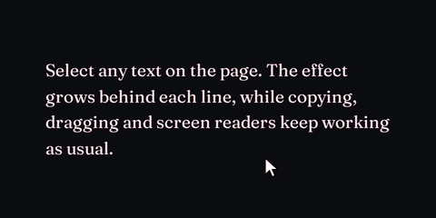

<h1>
<picture>
  <source media="(prefers-color-scheme: light)" srcset="media/banner-light.png" />
  
</picture>
</h1>

Text selection effects, rendered with WebGL. The selection itself stays native, so copying, dragging and screen readers work as usual.

Every day, hundreds of millions of people highlight text. They do it to copy a quote, to keep their place, to think. And every time, the browser answers with the same flat rectangle it has drawn since 1995. HyperSelect replaces that rectangle with something alive.



Tested in Chrome and Firefox, on desktop and on Android. It has not been tested in Safari or in any iOS browser yet; see [Compatibility](packages/hyperselect#compatibility).

| Package                                         | Description                                       |
| ----------------------------------------------- | ------------------------------------------------- |
| [`hyperselect`](packages/hyperselect)           | The engine: reads the selection and draws presets |
| [`@hyperselect/presets`](packages/presets)      | 220 presets in eleven categories                  |
| [`site`](apps/site)                             | The demo page                                     |
| [`e2e`](e2e)                                    | Browser tests for alignment, rendering and speed  |

## Development

```sh
pnpm install
pnpm dev          # demo site
pnpm typecheck
pnpm test         # unit tests
pnpm test:e2e     # browser tests
pnpm test:perf    # frame rate, script time and memory
pnpm build
```

`test:perf` throttles the CPU to match an i7-12700H slowed 16 times, calibrated against a benchmark run on your machine, so its results compare across CPUs. The GPU cannot be throttled, so a slower GPU than the reference's shows worse numbers. Each run prints the CPU, the throttle and the GPU it measured with, and every preset's p95 frame time. It never fails: it warns when a preset drops below 30 fps, misses 60 fps, spends too long in script or grows the heap past its budget.

Pushing to `main` deploys the demo site to GitHub Pages. CI runs typecheck, unit tests, the build and the bundle size gate. The e2e suite is too heavy for GitHub Actions, so run it locally.

## Contributing

### Rules

- Keep code minimal, readable and maintainable. Names should explain the code, so add comments only where they are indispensable.
- Use proper structure and patterns, without overcomplicating.
- The selling point is polish and refinement, not fancy gradients.
- After any visual change, check performance: up to 16× CPU throttle, memory use and smoothness.
- US English and plain wording in docs and on the site.
- No recreations of existing games or characters.

### Looks to keep

- Freeze is the reference look. Don't simplify it, and keep its white cracks and cold vapor. On the light theme it is pale, not blue.
- Keep volt's sparks.
- Paper has no particles.
- Legibility matters, but don't flatten a look to pass a strict contrast check.

### Pitfalls

- Shaders use `highp` floats and ints. Without them, Mali GPUs break fire into chopped tiles.
- `hash` rounds its input and hashes 32-bit integers, because Mali reassociates float math. `shaderHash` in `packages/presets/src/math.ts` must stay identical to the GLSL `hash`.
- Keep a preset to about 3 `fbm` and 1 `voronoi` per pixel on the hot path, with early returns and the smallest pad that still shows the look.
- Preset factories such as `rise`, `toss` and `drift` are marked `/* @__NO_SIDE_EFFECTS__ */`. Without the mark, importing one preset bundles every preset a factory builds.
- A preset's `tint` is the demo site's accent color, so it must be a real color.
- Effects draw on a regular canvas. In Firefox an OffscreenCanvas blocks on a full GPU readback every frame, and so does each `drawImage` from a WebGL canvas, which is why layers and badges copy from one staged 2D capture.
- The WebGL canvas sits in a clipping div, because the atlas rounds up to 256 px and Firefox Android otherwise zooms the page out.
- Compare builds on phones with interleaved A/B runs. Charging and long runs heat the phone and skew back-to-back results.
- In Firefox on Android, `will-change`, fixed positioning, a top z-index, rendering after paint and adaptive resolution were all tried, and none helped enough.

### Releasing

- Publish with `pnpm publish`, which turns `workspace:^` into a real version range. `npm publish` doesn't.
- Publish `hyperselect` first, then `@hyperselect/presets`.
- The `Preset` interface and everything a shader can read are public API. Changing them is a major release.

## License

MIT
