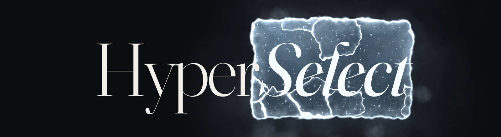
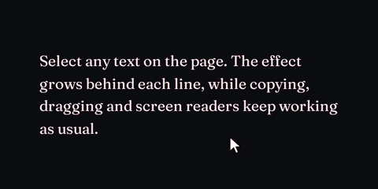
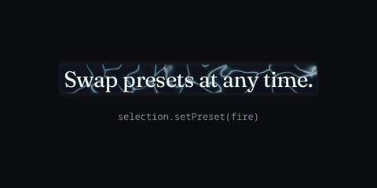
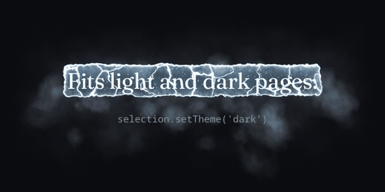
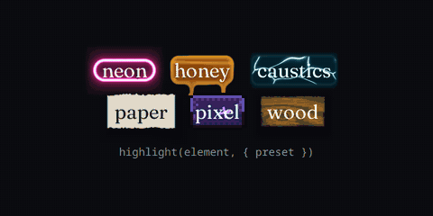

<h1>
<picture>
  <source media="(prefers-color-scheme: light)" srcset="https://raw.githubusercontent.com/alixsep/hyperselect/main/media/banner-light.png" />
  
</picture>
</h1>

Text selection effects, rendered with WebGL.

Every day, hundreds of millions of people highlight text. They do it to copy a quote, to keep their place, to think. And every time, the browser answers with the same flat rectangle it has drawn since 1995. HyperSelect replaces that rectangle with something alive.



## Principles

- **Never fight the browser.** The selection stays native. HyperSelect reads its geometry and draws behind it; nothing is wrapped, cloned or re-rendered.
- **Respond instantly, finish gracefully.** Effects begin the moment a line appears, and nothing is cut off when you click away.
- **Idle costs nothing.** With nothing selected and nothing animating, no frames are drawn at all.
- **Respect the reader.** With reduced motion enabled, surfaces appear without particles or movement.

## Install

```sh
pnpm add hyperselect @hyperselect/presets
```

`hyperselect` is the engine. The effects live in `@hyperselect/presets`, released on their own schedule, or you can write your own.

## Usage

```ts
import { createHyperSelect } from "hyperselect";
import { fire, volt } from "@hyperselect/presets";

const selection = createHyperSelect({ preset: volt });

selection.setPreset(fire);
selection.setTheme("light");
selection.destroy();
```





| Option    | Default                    | Description                                                                                                                                 |
| --------- | -------------------------- | ------------------------------------------------------------------------------------------------------------------------------------------- |
| `preset`  | required                   | The effect to draw.                                                                                                                         |
| `theme`   | system preference          | `'dark'` or `'light'`, to match your page. Left out, it follows the system as it changes. Containers with their own background follow their own colors. |
| `root`    | `document.documentElement` | Only selections inside this element get the effect.                                                                                         |
| `zIndex`  | `-1`                       | Stacking order of the effect layer.                                                                                                         |
| `padding` | `0`                        | Extra space around each selected line, in pixels: one number for every side, or `{ top, right, bottom, left }` with any side left out at 0. |
| `adaptive` | `false`                   | Lowers the render resolution while frames are slow and restores it once they recover.                                                      |

Import only the presets you use; the rest are tree-shaken. The engine with one preset weighs about 14 kB gzipped.

### Frameworks

Create one instance when your app mounts and destroy it when it unmounts. Importing and calling it during server rendering is safe; it does nothing there.

```tsx
useEffect(() => {
  const selection = createHyperSelect({ preset: volt });
  return () => selection.destroy();
}, []);
```

Keep the instance in a ref to call `setPreset` or `setTheme` later instead of recreating it.

## Permanent highlights

`highlight` draws an effect on an element's text all the time, selected or not, for labels, badges or a preset picker:



```ts
import { highlight } from "hyperselect";

const badge = highlight(element, { preset: fire });

badge.setPreset(volt);
badge.destroy();
```

All highlights share one WebGL context, animate only while on screen, and follow the element when it resizes. `theme` works as above. The effect canvas is appended to the element, which becomes `position: relative` if it was static.

## Custom presets

A preset is a plain object with a GLSL surface, and optionally particles.

```ts
import { createHyperSelect, type Preset } from "hyperselect";

const bubbles: Preset = {
  name: "bubbles",
  pad: [16, 40, 12],
  tint: [0.3, 0.6, 1],
  selection: { dark: "color:#fff", light: "color:#0b1a2e" },
  surface: /* glsl */ `
    vec4 surface(float t, float age, float fade, float seed, float cover) {
      float a = smoothstep(1.0, -1.0, sdRBox(local, halfSize + 3.0, 6.0)) * min(age * 5.0, 1.0) * fade * 0.6;
      return vec4(uTint * a, a);
    }`,
  sprite: /* glsl */ `
    vec4 sprite(vec2 p, float life, float alpha, float seed, float kind, float t) {
      float a = smoothstep(0.15, 0.0, abs(length(p) - 0.8)) * alpha;
      return vec4(uTint * a, a);
    }`,
  behavior: () => ({
    emit(line, { pool, dt }) {
      if (Math.random() > line.w * 0.02 * dt) return;
      const i = pool.spawn(line.id);
      if (i < 0) return;
      pool.x[i] = line.x + Math.random() * line.w;
      pool.y[i] = line.y;
      pool.vy[i] = -40;
      pool.size[i] = 6 + Math.random() * 6;
      pool.life[i] = 1.5;
    },
    update(i, { pool, dt }) {
      pool.move(i, dt);
      pool.alpha[i] = 1 - pool.age[i] / pool.life[i];
      return pool.age[i] < pool.life[i];
    },
  }),
};

createHyperSelect({ preset: bubbles });
```

| Field       | Description                                                                                 |
| ----------- | ------------------------------------------------------------------------------------------- |
| `name`      | Set as `data-hyperselect` on the root while active.                                         |
| `pad`       | Pixels the surface may draw beyond each line: sides, top, bottom. Edges fade out within it. |
| `tint`      | The preset's hue, as `uTint`. On light pages, glow brighter than its alpha is drawn in it.  |
| `selection` | CSS for `::selection` per theme, to keep text readable on the effect.                       |
| `surface`   | GLSL drawn once per selected line.                                                          |
| `sprite`    | GLSL drawn once per particle.                                                               |
| `behavior`  | Creates the particle logic. Called again whenever the preset is applied.                    |

### Shaders

Both functions return premultiplied RGBA and are drawn behind the text.

`surface(t, age, fade, seed, cover)` receives the time in seconds, the line's age in seconds, its opacity, a random seed in [0, 1), and 1 when another selected line sits directly above it. It also reads:

- `local`: pixel position relative to the line's center, y pointing down
- `halfSize`: half the line's width and height in pixels
- `world`: pixel position on the page

`sprite(p, life, alpha, seed, kind, t)` receives the position in the particle's square, from -1 to 1 with y up, the fraction of its life spent, its opacity, its seed, its kind and the time. `params` holds its four extra values.

Both can use `uTint`, `uLight` (0 dark, 1 light), `PI`, `hash`, `hash2`, `noise`, `fbm`, `fbm3`, `voronoi`, `sdBox`, `sdRBox` and `over`. A shader that fails to compile logs the preset's name and the compiler error, with line numbers counted from the start of your shader string, and draws nothing.

### Particles

`emit(line, sim)` runs every frame for each selected line, and `update(index, sim)` for each live particle; returning `false` removes it. `sim` holds `pool`, `lines`, `dt` and `time`.

A line has `id`, `x`, `y`, `w`, `h` in page pixels, plus `age`, `alpha`, `seed` and `cover`. `lines.edgeCovered(line, top, x)` tells whether another selected line touches its top or bottom edge at `x`.

`pool.spawn(line.id)` returns a particle index, or -1 when the pool is full. Each particle has these fields, indexed by it:

- `x`, `y`, `vx`, `vy`: position and velocity in page pixels; `pool.move(index, dt)` applies the velocity
- `size`, `rot`, `spin`: side length of its square in pixels, rotation and a free rotation speed
- `age`, `life`: seconds lived, advanced for you, and seconds to live
- `alpha`, `seed`, `kind`: opacity, a random value, and a kind from 0 to 255 for the sprite to branch on
- `base`: free, typically the size before animation
- `params`: four floats per particle at `index * 4`, passed to the sprite
- `line`: the id of the line it was spawned for

Particles keep drawing after their line is deselected, until they are removed. State a behavior needs beyond these lives in the closure that `behavior` returns.

## Notes

- Effects sit behind your text. For text on the page itself the effect layer is a child of `<html>`, outside your content, so selectors like `:last-child` are unaffected. Text inside a container with its own background, such as a card, a code block, a sticky header or a dialog, gets its effect drawn inside that container, so it follows the container through scrolling, sticky and fixed positioning and transforms. While text is selected, that layer is the container's last child, which `:last-child` and `:empty` rules on its children will notice.
- The layer lives in the document and scrolls with it, so the effect stays on the text while the page scrolls, zooms or reflows, including inside scrolling containers and on mobile.
- Rotated, skewed, mirrored, unevenly scaled, 3D-transformed and vertical text keeps a native highlight, since the effect is drawn along horizontal lines.
- The effect follows text that moves without a DOM change, such as on hover or during a CSS animation.
- Selected text is recolored to stay readable on the effect beneath it. Text the browser won't select, such as `user-select: none`, hidden or inert content, gets neither. While text is selected, its element carries `data-hyperselect-selected`: empty when it follows `theme`, `light` or `dark` when its container looks otherwise, and `native` when it keeps the native highlight.
- Add `data-hyperselect-ignore` to an element to keep the native highlight inside it, for example on code blocks with their own selection styling.
- Without WebGL2 the page keeps its native selection and nothing is added. In forced colors mode, such as Windows high contrast, the native highlight is kept too.
- Nothing is injected as markup: styles go through constructable stylesheets and the CSS object model, so a strict Content Security Policy without `'unsafe-inline'` works.
- If something removes the effect canvas, such as a framework re-rendering its container, it is put back on the next frame. A lost WebGL context is restored, for selections and highlights alike.
- Selections inside shadow roots keep the native highlight. Each iframe needs its own instance.
- With `prefers-reduced-motion`, surfaces are drawn without particles or movement.
- Very large selections, like selecting a whole page, are drawn at a lower resolution and frame rate to keep the GPU load modest.
- Nothing is rendered while nothing is selected or animating.

## Performance

The cost depends mostly on the preset. Surfaces such as wood or paper are a single shader pass and run smoothly almost anywhere. Particle presets such as volt, fire and freeze simulate and draw thousands of sprites, and with a large selection they can drop below 60 fps on budget phones and integrated GPUs. Try the presets you ship on the slowest device your audience uses, with a long passage selected, and prefer a lighter preset where it struggles.

## Compatibility

Tested in Chrome and Firefox, on desktop and on Android. On weaker Android GPUs, Firefox runs heavy presets at about half the frame rate Chrome does, because compositing the effect costs it more.

Safari and WebKit have not been tested at all. That includes every browser on iOS, since Chrome and Firefox there run on WebKit too. The effect may misalign, look different or fail to appear, and iOS draws its own selection handles and overlay.

## Roadmap

### Selection

- [x] Keep the selection native, so copying, dragging and screen readers work as usual. The browser's highlight is made transparent and each preset sets a readable text color per theme.
- [x] Take geometry from the browser's own selection rects, so the effect lands where that browser actually selects.
- [x] Skip text the browser won't select: `user-select: none`, hidden and inert content.
- [x] Keep the native highlight where the effect can't be right: transformed or vertical text, shadow roots, forced colors, `data-hyperselect-ignore` and browsers without WebGL2.
- [x] Follow text through scrolling, zooming, reflow, sticky and fixed positioning, transforms and CSS animations.
- [x] Configurable padding on each side.
- [ ] Draw selections inside open shadow roots.
- [ ] Draw rotated, skewed, 3D-transformed and vertical text.
- [ ] Skip text hidden with `opacity: 0`, `clip-path`, `content-visibility` or `mask`.
- [ ] Handle ruby annotations, `::first-line`, `initial-letter` drop caps and very tall inline images.
- [ ] Notice text that reflows inside an element whose box stays the same. The tracker samples 32 of the selected elements, and highlights re-measure only on resize and font load.

### Rendering

- [x] WebGL2 directly, with no library. The engine is about 13 kB gzipped.
- [x] Draw page text in a layer on `<html>`, and text in cards, code blocks, sticky headers and dialogs in a layer inside that container, so opaque containers neither hide the effect nor get covered by it.
- [x] Size each layer to the region it draws, not the viewport.
- [x] One WebGL context for every layer and every `highlight()` badge, packed into one atlas.
- [x] Render nothing while nothing is selected or animating.
- [x] Cap very large selections at a pixel budget, so resolution drops instead of the GPU choking.
- [x] Work under a strict Content Security Policy, with no injected markup.
- [x] Recover from a removed canvas or a lost WebGL context.
- [x] Respect `prefers-reduced-motion` and forced colors.
- [ ] Draw inside painted containers without adding a child element, so `:last-child` and `:empty` rules keep matching, and without `isolation: isolate`, so `mix-blend-mode` inside is unaffected.

### Presets

- [x] 220 presets in their own package, released on their own schedule.
- [x] Custom presets as plain objects holding GLSL, with no builder layer to learn or break.
- [x] Light and dark variants for every preset.
- [x] Stable names: a preset keeps its name while its look is refined, and one that becomes something else gets a new name.
- [x] Import one preset and ship only that one.
- [x] No full-area flashing faster than about 3 Hz.
- [x] Noise that stays seamless on Mali GPUs, which broke fire and clouds into tiles.
- [ ] Polish the weaker weather, art, digital and playful presets.
- [ ] Keep text readable before the effect arrives on tar, ferro, salt, sulfur, acid and the materials.
- [ ] Stop strokes overlapping on stacked lines in outline, pulse, halo, glow, orbit and charge.
- [ ] Strengthen galaxy, wormhole and glint, and set bloom further apart from glow.

### Performance

- [x] Performance tests calibrated to a 16× CPU throttle, so results compare across machines.
- [x] Faster on phones and in Firefox: an idle Firefox phone went from 37 to 46 fps, and laptop Firefox from 77 to 138 fps.
- [x] Adaptive resolution as an opt-in, so full quality is the default.
- [ ] A cheaper particle simulation, so volt and fire hold 60 fps with a whole article selected.
- [ ] Close the gap in Firefox on Android, where heavy presets run at about half Chrome's frame rate.

### Compatibility

- [x] Chrome and Firefox, on desktop and on Android.
- [ ] Safari and iOS, including Safari's own selection overlay and handles.

## Versioning

The `Preset` interface and everything a shader can read, listed above, are the engine's public API. Changing any of them is a breaking release, because it breaks custom presets as well as `@hyperselect/presets`, which declares the engine versions it supports as a peer dependency.

## License

MIT
