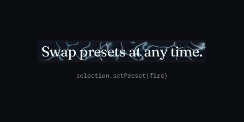

# @hyperselect/presets

220 text selection effects for [hyperselect](https://www.npmjs.com/package/hyperselect), in eleven categories of twenty.



```sh
pnpm add hyperselect @hyperselect/presets
```

```ts
import { createHyperSelect } from "hyperselect";
import { volt } from "@hyperselect/presets";

createHyperSelect({ preset: volt });
```

Import presets by name and only those end up in your bundle. `categories` groups all of them, for pickers and galleries; importing it includes every preset.

| Category    | Presets                                                                                                                                                       |
| ----------- | ------------------------------------------------------------------------------------------------------------------------------------------------------------- |
| `basic`     | marker, highlighter, underline, outline, glow, ribbon, stripes, dots, gradient, pulse, shadow, block, wash, halo, brackets, squiggle, frame, spotlight, sweep, pill |
| `nature`    | moss, wood, leaves, grass, sand, water, stone, bark, vines, petals, honey, coral, pollen, dew, lichen, pebbles, fern, bamboo, mud, seaweed                     |
| `elements`  | fire, freeze, volt, lava, smoke, steam, embers, plasma, acid, frost, mercury, ash, tar, flare, charge, ferro, salt, sulfur, wisp, dust                        |
| `materials` | paper, chrome, gold, glass, marble, velvet, denim, leather, concrete, rust, copper, silk, felt, cork, tape, cardboard, foil, enamel, granite, plaster          |
| `light`     | neon, aurora, prism, laser, hologram, sunbeam, candle, lantern, fireflies, bloom, caustics, rainbow, glint, sunset, dawn, lens, beacon, afterglow, ultraviolet, moonlight |
| `space`     | nebula, galaxy, stars, comet, meteor, eclipse, quasar, supernova, wormhole, abyss, orbit, stardust, solar, lunar, mars, rings, asteroids, warp, constellation, gravity |
| `weather`   | rain, snow, fog, hail, storm, drizzle, sleet, wind, tornado, sandstorm, monsoon, blizzard, haze, heatwave, clouds, drought, hurricane, puddles, icicles, sunshower |
| `art`       | watercolor, ink, crayon, chalk, pencil, charcoal, oil, pastel, graffiti, stencil, halftone, comic, stipple, mosaic, woodcut, gouache, fresco, origami, collage, blot |
| `digital`   | pixel, glitch, matrix, terminal, crt, vhs, circuit, binary, ascii, vaporwave, synthwave, arcade, lcd, wireframe, datamosh, hex, dither, radar, grid, scanner |
| `playful`   | confetti, bubbles, candy, sparkles, hearts, glitter, balloons, jelly, sprinkles, slime, fireworks, stickers, doodles, popcorn, bubblegum, disco, frosting, yarn, gumballs, kites |
| `holidays`  | halloween, haunted, christmas, gingerbread, valentine, newyear, sparkler, easter, shamrock, diwali, firecracker, hanukkah, harvest, eid, holi, picado, birthday, oktoberfest, mardigras, mooncake |

## How presets change

Releases can adjust a preset's color, texture and motion, so it may look a little different after an update.

- Adjustments ship in minor and patch releases and are listed in the [changelog](CHANGELOG.md).
- A preset that changes into something else gets a new name, and the old one stays as it was.
- Removing or renaming a preset is a breaking release.

To keep a look exactly as it is, pin the version, or copy the preset's file into your project and pass it as a custom preset. It is a plain object, so your copy never changes.
